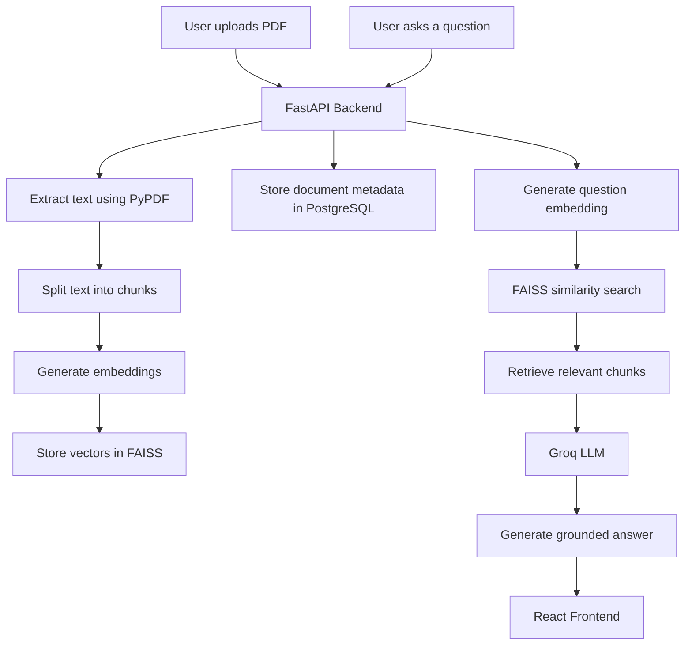

# KnowledgeFlow

KnowledgeFlow is a Retrieval-Augmented Generation (RAG) application that allows users to upload PDF documents and ask questions based on their content.

## Features

- **PDF Upload:** Upload PDF documents for processing.
- **Document Processing:** Extract text, split it into chunks, and generate embeddings.
- **Semantic Search:** Retrieve relevant document chunks using FAISS similarity search.
- **AI-Powered Question Answering:** Generate answers using retrieved context and the Groq LLM.
- **Document Management:** View uploaded documents and delete them when no longer needed.
- **Duplicate Detection:** Detect duplicate PDF files using SHA-256 hashing.

## Tech Stack

### Frontend
- React
- Vite
- React Markdown

### Backend
- Python
- FastAPI

### RAG Pipeline
- LangChain Text Splitters
- Sentence Transformers
- FAISS
- Groq LLM

### Database
- PostgreSQL

### Document Processing
- PyPDF
- SHA-256 Hashing

### Infrastructure
- Docker

## Architecture



## Installation and Setup

### Prerequisites

Make sure the following tools are installed:

- Python
- Node.js and npm
- Docker Desktop
- Git

### 1. Clone the repository

```bash
git clone https://github.com/Vainikachowdary/knowledge-flow.git
cd knowledge-flow
```

### 2. Configure environment variables

Create your environment file:

```powershell
Copy-Item .env.example .env
```

Update the `.env` file with your own database credentials and Groq API key before starting the backend.

Make sure the database password matches the password configured for PostgreSQL in `docker-compose.yml`.

### 3. Start the PostgreSQL database

From the project root directory, run:

```bash
docker compose up -d
```

This starts the PostgreSQL container in the background.

### 4. Set up the backend

Navigate to the backend directory:

```bash
cd backend
```

Create a virtual environment:

```bash
python -m venv .venv
```

Activate it on Windows PowerShell:

```powershell
.\.venv\Scripts\Activate.ps1
```

Install dependencies:

```bash
pip install -r requirements.txt
```

Create the database table:

```bash
python create_table.py
```

Start the backend server:

```bash
python -m uvicorn main:app --reload
```

The backend server runs at:

http://127.0.0.1:8000

Interactive API documentation (Swagger UI):

http://127.0.0.1:8000/docs

### 5. Set up the frontend

Open a new terminal and navigate to the frontend directory from the project root:

```bash
cd frontend
```

Install dependencies:

```bash
npm install
```

Start the development server:

```bash
npm run dev
```

The frontend will be available at:

http://localhost:5173

### Stopping the application

Press `Ctrl + C` in each terminal to stop the frontend and backend servers.

From the project root directory, stop the PostgreSQL container:

```bash
docker compose down
```

## API Endpoints

### 1. Upload PDF

**Endpoint:** `POST /upload`

**Description:** Uploads a PDF document, extracts its text, splits it into chunks, generates embeddings, and stores the document metadata.

**Request:** Multipart form data containing a PDF file.

**Successful response:**

```json
{
  "filename": "example.pdf",
  "chunks": 12
}
```

### 2. Chat with documents

**Endpoint:** `POST /chat`

**Description:** Accepts a user question, retrieves relevant document chunks using FAISS, and generates a context-based answer using the Groq LLM.

**Request body:**

```json
{
  "question": "What is this document about?"
}
```

**Successful response:**

```json
{
  "your_answer": "The document discusses..."
}
```

### 3. Get uploaded documents

**Endpoint:** `GET /documents`

**Description:** Retrieves the list of uploaded documents and their metadata.

### 4. Delete a document

**Endpoint:** `DELETE /documents/{document_id}`

**Description:** Deletes a document using its unique ID, including its stored PDF, associated metadata, and in-memory vector data.

## Error Handling

| Status Code | Description |
|---|---|
| 400 | Invalid PDF or request |
| 404 | Document not found |
| 409 | Duplicate PDF upload |
| 500 | Internal server error |

## Duplicate Detection

KnowledgeFlow uses SHA-256 hashing to identify duplicate PDF uploads.

The hash is generated from the file content rather than its filename. This helps prevent duplicate records when the same PDF is uploaded under different filenames.

## Known Limitations

- The FAISS vector index is maintained in memory and is lost when the backend restarts.
- Previously uploaded documents remain registered in PostgreSQL, but their embeddings are not automatically reloaded into FAISS on startup. Chat functionality remains unavailable until the index is rebuilt.

## Future Improvements

- Improve vector index persistence and recovery.
- Introduce authentication and secure document access.
- Enhance retrieval performance and scalability.